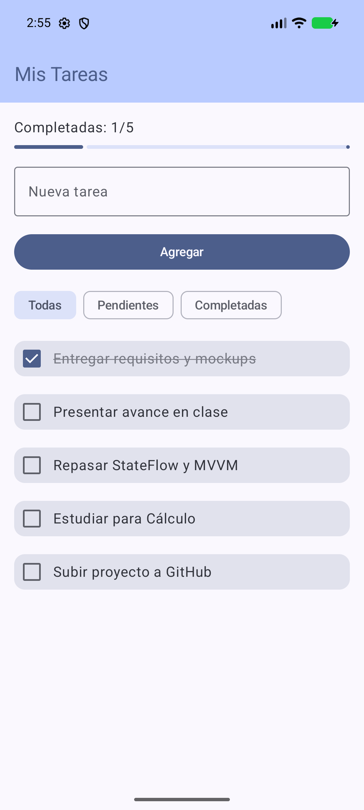
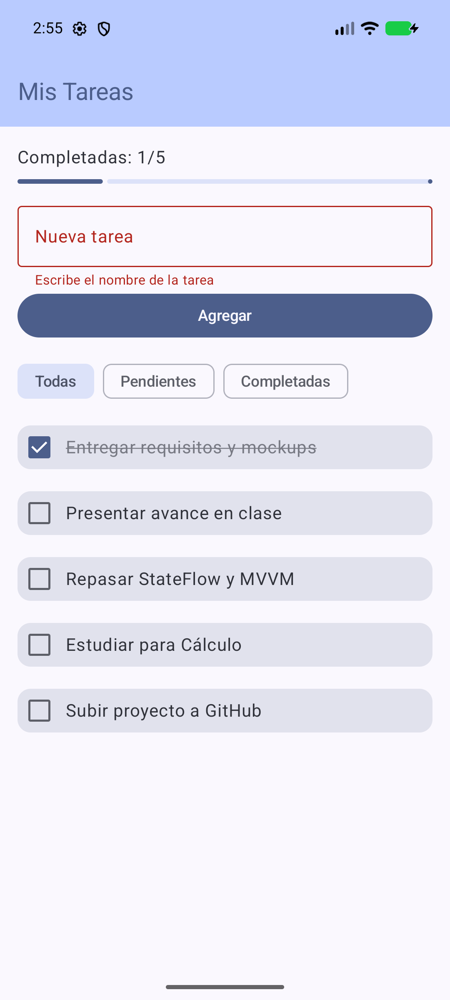
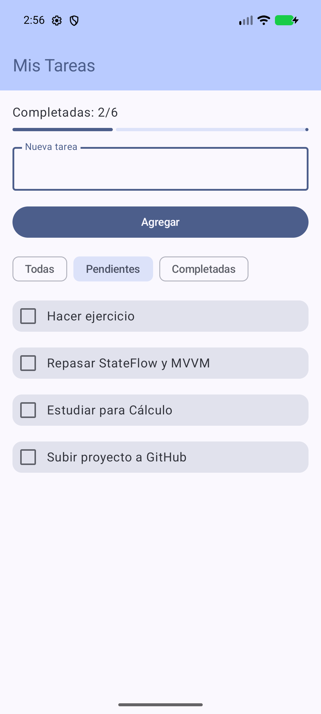
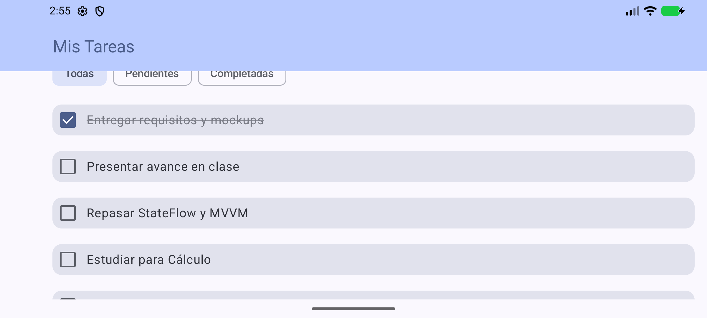
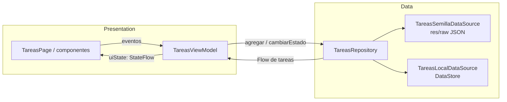

# Mis Tareas

Aplicación Android de lista de tareas (ToDo) hecha con **Jetpack Compose** y arquitectura **MVVM**.
Carga tareas base desde un archivo JSON local y guarda las tareas del usuario con **DataStore (Preferences)**.
No usa APIs externas, ni SQLite, ni Room.

Asignatura: Desarrollo de Aplicaciones Móviles. Proyecto SH01, avance.

## Capturas

| Inicio (datos semilla) | Validación | Filtro "Pendientes" |
|---|---|---|
|  |  |  |

Horizontal (toda la pantalla tiene scroll):



## Requisitos funcionales (RF)

| Id | Requisito |
|----|-----------|
| RF-01 | La primera vez que se abre la app, se muestran las tareas base del archivo `res/raw/tareas_semilla.json`. |
| RF-02 | El usuario puede escribir el nombre de una tarea nueva y agregarla a la lista. |
| RF-03 | La app no deja agregar una tarea vacía, con más de 40 caracteres o con un nombre que ya existe, y muestra el error debajo del campo. |
| RF-04 | Al tocar una tarea, se marca como completada (o se desmarca si ya lo estaba). |
| RF-05 | El usuario puede filtrar la lista: Todas, Pendientes o Completadas. |
| RF-06 | Se muestra cuántas tareas están completadas del total y una barra de progreso. |
| RF-07 | Las tareas agregadas y los cambios de estado se guardan en el dispositivo y siguen ahí al cerrar y volver a abrir la app. |

## Requisitos no funcionales (RNF)

| Id | Requisito |
|----|-----------|
| RNF-01 | App nativa en Kotlin con Jetpack Compose y Material 3. |
| RNF-02 | Arquitectura MVVM con dos capas: Presentation (Composables, UI State, ViewModel) y Data (Repository, Data Sources). |
| RNF-03 | Persistencia solo con DataStore Preferences. Prohibido usar APIs remotas, SQLite o Room. |
| RNF-04 | El estado de la pantalla se expone con `StateFlow` y se consume con `collectAsStateWithLifecycle()`. |
| RNF-05 | El estado no se pierde al girar la pantalla (vive en el ViewModel). |
| RNF-06 | Todos los textos de la interfaz están en `strings.xml` (sin textos fijos en el código). |
| RNF-07 | Funciona sin internet. Android 8.0 (API 26) o superior. |

## Modelo de datos

```kotlin
data class Tarea(
    val id: Int,
    val titulo: String,
    val completada: Boolean = false
)
```

Datos semilla (`app/src/main/res/raw/tareas_semilla.json`):

```json
[
  { "id": 1, "titulo": "Entregar requisitos y mockups", "completada": true },
  { "id": 2, "titulo": "Presentar avance en clase", "completada": false }
]
```

En DataStore toda la lista se guarda como texto JSON en una sola clave (`lista_tareas`).
Si esa clave todavía no existe, el repositorio devuelve la semilla.

## Estructura del estado

```kotlin
data class TareasUiState(
    val cargando: Boolean = true,              // estado inicial, antes de que llegue la lista
    val tareasVisibles: List<Tarea> = emptyList(), // ya filtradas
    val filtro: Filtro = Filtro.TODAS,
    val textoNuevaTarea: String = "",
    @StringRes val error: Int? = null,
    val totalTareas: Int = 0,
    val tareasCompletadas: Int = 0,
    val progreso: Float = 0f
)
```

## Arquitectura



### Cómo fluye un evento (ejemplo: marcar una tarea)

1. El usuario toca una tarea: `TareaItem` llama a `onClick()`.
2. `TareasPage` lo pasa al ViewModel: `viewModel.onTareaClick(id)`.
3. El ViewModel llama a `repositorio.cambiarEstado(id)` dentro de `viewModelScope.launch`.
4. El repositorio cambia `completada` de esa tarea y llama a `local.guardar(lista)`.
5. DataStore guarda el JSON y su `data` vuelve a emitir.
6. `repositorio.tareas` emite la lista nueva y el ViewModel la recibe en su `collect` (en el `init`).
7. `calcularEstado()` aplica el filtro y los contadores, y se actualiza `_uiState`.
8. `uiState` emite el estado nuevo, `collectAsStateWithLifecycle()` lo recibe y Compose vuelve a dibujar la pantalla.

## Estructura de paquetes

```
com.upchiapas.mistareas
├── MainActivity.kt
├── data/
│   ├── Tarea.kt
│   ├── TareasJson.kt
│   ├── TareasSemillaDataSource.kt
│   ├── TareasLocalDataSource.kt
│   └── TareasRepository.kt
└── presentation/
    ├── tareas/
    │   ├── TareasUiState.kt
    │   ├── TareasViewModel.kt
    │   ├── TareasPage.kt
    │   └── components/
    │       ├── ResumenTareas.kt
    │       ├── FormularioTarea.kt
    │       ├── FiltrosTareas.kt
    │       └── TareaItem.kt
    └── theme/
```

## Estado del avance

Hecho:
- Carga de tareas semilla desde JSON.
- Agregar tarea con validaciones.
- Marcar y desmarcar tareas.
- Filtros y progreso.
- Guardado con DataStore.

Pendiente para la entrega final:
- Eliminar tareas.
- Pruebas unitarias del ViewModel.
- Reporte arquitectónico.

## Cómo correrlo

Abrir la carpeta en Android Studio, esperar a que termine el Gradle Sync y darle Run en un emulador o celular.
